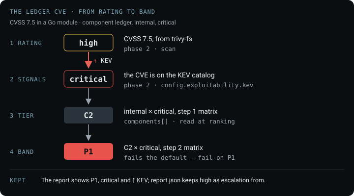
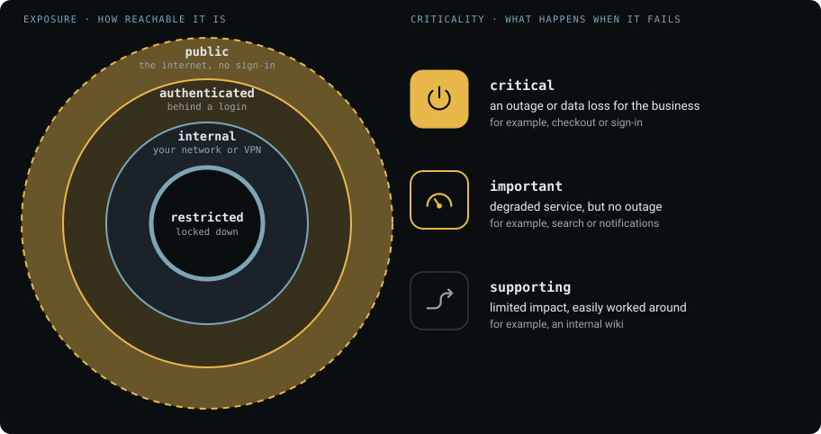
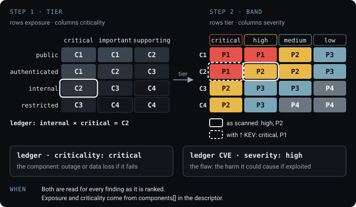
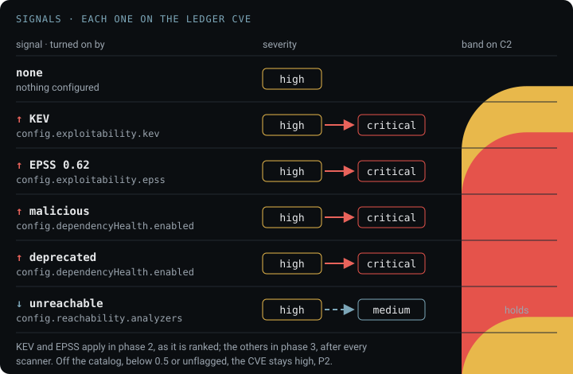
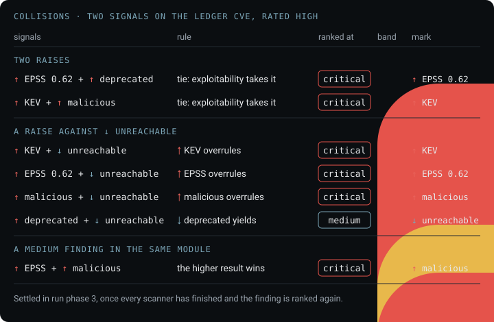
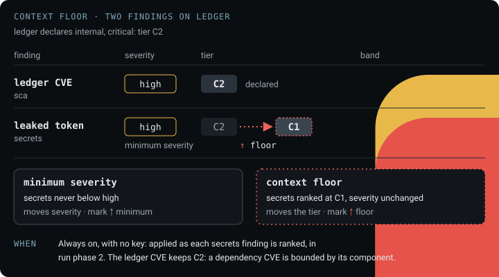
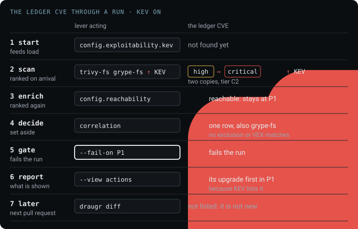
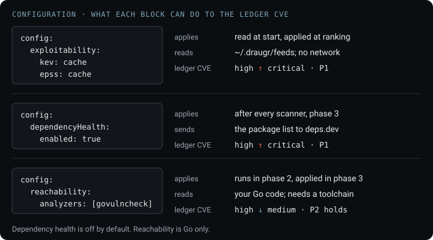

# Prioritization

<!-- menu: Model · Matrices · Signals · Collisions · Context floor · Examples · Configuration · Components -->

## Model

A scan of a real project returns hundreds of findings, and their severity alone does not say which
to fix first. A **band**, P1 to P4, is the order in which to fix findings. Draugr reads it from two inputs: the
**tier** of the component a finding is in, from its declared `exposure` and `criticality`, and the
finding's **severity**. Severity starts as the scanner's rating, and **signals** from outside the
code move it before the band is read: KEV, EPSS and dependency health raise it, reachability lowers
it. The **context floor** moves the tier for a leaked credential.

This page follows one finding through each step, and so does
[Reducing the noise](reducing-the-noise.md). The **ledger CVE** is a CVSS 7.5 flaw in a Go module
that the `ledger` component depends on; `ledger` declares `exposure: internal` and
`criticality: critical`.



A finding's **ranked severity** is the scanner's rating held at the control's severity floor and
then moved by every signal, the severity the report prints for the finding. The band is read from
it, the report prints it with the band and a mark naming the signal that moved it, and a severity
gate judges it, as [Verdict & gating](verdict-and-gating.md#verdict--exit-code) describes.
The scanner's rating is never rewritten; `report.json` and the SARIF carry it unchanged.

| band | act |
|---|---|
| <span class="dr-p1">P1</span> | now |
| <span class="dr-p2">P2</span> | this cycle |
| <span class="dr-p3">P3</span> | backlog |
| <span class="dr-p4">P4</span> | track |

The levers that act on a band, declaring a component, turning on a signal and `--min-priority`, are
in [Reducing the noise](reducing-the-noise.md#ranking). Which findings fail a build, and whether the
ledger CVE fails one, is the [Gate](reducing-the-noise.md#gate); how the verdict and exit code are
reached is in [Verdict & gating](verdict-and-gating.md).

## Matrices

The **tier**, C1 to C4, is how much a flaw on a component can matter, read from what the descriptor
declares about the component. Step 1 crosses `exposure` with `criticality` into the tier; step 2
crosses the tier with severity into the band. For the ledger CVE, `internal` and `critical` give C2,
and C2 with high gives P2.





Both matrices are fixed in the code and read for every finding as it is ranked; nothing in them is
inferred at run time. Raising exposure, criticality or severity never lowers a band. P1 is kept
scarce: only a critical or high finding on one of the two most exposed tiers reaches it.

Declare the two fields in [`components`](../reference/saga-schema.md#components), or run
[`draugr classify`](../reference/cli.md#draugr-classify-sagayaml--directory) to be asked for them.

### Step 1, tier

| `exposure` | `critical` | `important` | `supporting` |
|---|---|---|---|
| `public` | C1 | C1 | C2 |
| `authenticated` | C1 | C2 | C3 |
| `internal` | C2 | C3 | C4 |
| `restricted` | C3 | C4 | C4 |

### Step 2, band

| tier | <span class="dr-crit">critical</span> | <span class="dr-high">high</span> | <span class="dr-med">medium</span> | <span class="dr-low">low</span> |
|---|---|---|---|---|
| C1 | <span class="dr-p1">P1</span> | <span class="dr-p1">P1</span> | <span class="dr-p2">P2</span> | <span class="dr-p3">P3</span> |
| C2 | <span class="dr-p1">P1</span> | <span class="dr-p2">P2</span> | <span class="dr-p2">P2</span> | <span class="dr-p3">P3</span> |
| C3 | <span class="dr-p2">P2</span> | <span class="dr-p3">P3</span> | <span class="dr-p3">P3</span> | <span class="dr-p4">P4</span> |
| C4 | <span class="dr-p2">P2</span> | <span class="dr-p3">P3</span> | <span class="dr-p4">P4</span> | <span class="dr-p4">P4</span> |

### Two meanings of critical

| field | describes | values | for the ledger CVE |
|---|---|---|---|
| `criticality` | the component: the business impact if it fails | `critical` · `important` · `supporting` | `ledger` is `critical` |
| `severity` | the flaw: the harm it could cause if exploited | `critical` · `high` · `medium` · `low` | the CVE is `high` |

Neither implies the other. A critical component carries low-severity findings, and a supporting one
can carry a critical flaw.

<a id="where-the-severity-in-step-2-comes-from"></a>

### Where severity comes from

The ledger CVE's high comes from its CVSS score, 7.5.

| the scanner reports | severity |
|---|---|
| CVSS 9.0 to 10.0 | <span class="dr-crit">critical</span> |
| CVSS 7.0 to 8.9 | <span class="dr-high">high</span> |
| CVSS 4.0 to 6.9 | <span class="dr-med">medium</span> |
| CVSS below 4.0 | <span class="dr-low">low</span> |
| a Semgrep rule's impact and likelihood | by the table in [`semgrep`](../../internal/scanners/semgrep.md#severity) |
| a Bandit finding's severity and confidence | by the table in [`sarif-import`](../../internal/scanners/sarif-import.md#bandit) |
| no score or rating: SARIF level `error` | <span class="dr-high">high</span> |
| SARIF level `warning` | <span class="dr-med">medium</span> |
| SARIF level `note` or `none` | <span class="dr-low">low</span> |

A Semgrep finding prints its rating beside it, `impact high · likelihood high`. A control may hold
its findings at a minimum, its **severity floor**: a `secrets` finding is never below `high`,
whatever its scanner called it. The severity floor draws no mark.

## Signals

A **signal** is a published statement about a flaw or a package that moves the finding's severity
one or more levels before the band is read. Each is off until it is turned on, and each names
itself on the finding it moved with a **mark**. On the ledger CVE, every raise reaches critical and
P1, and the lowering leaves P2 in place.



| mark | means | moves severity | turned on by | applied |
|---|---|---|---|---|
| <span class="dr-up">↑ KEV</span> | the CVE is on CISA's Known Exploited Vulnerabilities catalog | to <span class="dr-crit">critical</span> | `config.exploitability.kev` | as the finding is ranked |
| <span class="dr-up">↑ EPSS 0.62</span> | the EPSS score, printed to two places, is at or above `epssThreshold`, default 0.5 | up one level | `config.exploitability.epss` | as the finding is ranked |
| <span class="dr-up">↑ malicious</span> | the package is in the OSSF Malicious Packages Project | to <span class="dr-crit">critical</span> | `config.dependencyHealth.enabled` | after every scanner finishes |
| <span class="dr-up">↑ deprecated</span> | the publisher marked the version deprecated | up one level | `config.dependencyHealth.enabled` | after every scanner finishes |
| <span class="dr-down">↓ unreachable</span> | `govulncheck` found no call path to the flaw, Go only | down one level | `config.reachability.analyzers` | after every scanner finishes |

Two more marks share the line under a finding. `↑ floor` means a leaked credential, ranked at C1
whatever its component declares, as [Context floor](#context-floor) describes. `↩ history` means the
finding describes a commit rather than the current tree, so its path may be gone; it moves nothing.
A finding with no mark was ranked by exposure, criticality and severity alone.

KEV and EPSS reach only findings whose rule id holds a CVE, which is `sca` and `images`; dependency
health reaches only findings about a package. Absence never lowers a band: a CVE missing from KEV, a
low EPSS score and a package nobody has flagged rank as they would with no signal at all. Only
reachability lowers, and only from an analyzer that shows its method, as
[Reachability](#reachability) describes. Turning each signal on is the second lever in
[Reducing the noise](reducing-the-noise.md#ranking).

<a id="how-each-signal-is-produced"></a>

### Sources

| signal | produced by | refreshed | cannot tell you |
|---|---|---|---|
| KEV | CISA, on reliable evidence of exploitation in the wild | continuously | whether an attack will reach you |
| EPSS | FIRST, a model trained on observed exploitation | daily | whether a CVE with a low score is safe |
| malicious | the OSSF Malicious Packages Project, via deps.dev | as reports arrive | whether a package it has not seen is safe |
| deprecated | the package's publisher, via deps.dev | when the publisher acts | whether the flaw can fire in your code |
| unreachable | `govulncheck`'s call graph of your code and its dependencies | every scan | what the analysis could not see: reflection, dynamic dispatch, generated code |

How each source decides is on the learn pages: [EPSS & KEV](/learn/epss-and-kev/),
[dependency health](/learn/dependency-health/), [reachability](/learn/reachability/).

### Already critical

A signal that matches a finding already at critical raises nothing. CVE-2021-44228 scores 10.0 and
is on KEV; on `ledger` it is already critical and P1 before KEV is read. The listing still counts:

- the finding draws no `↑ KEV` mark, because its band did not move;
- `report.json` and the SARIF record the listing under `exploited`;
- the `SIGNALS` line counts it as listed and not raised, `2 findings listed · 1 raised`;
- the action that clears it comes [first in its band](what-to-fix-first.md#how-the-list-is-ordered);
- it still overrules an unreachable verdict.

EPSS, malicious and deprecated on a finding already at critical record nothing, and `SIGNALS`
counts only the findings they raised.

## Collisions

A **collision** is two signals matching one finding. Two rules settle it, both applied after every
scanner has finished, when the finding is ranked again.



**Two raises: the higher resulting severity wins.** Exploitability asks whether the flaw is being
used; dependency health asks whether the package should be depended on at all. Neither is the
stronger claim, so the result decides and the mark names the signal that produced it. A tie goes to
exploitability, the statement about this specific flaw. On the ledger CVE every raise ends at
critical, so every pair of raises is a tie.

**A raise against an unreachable verdict: it depends on what the raise claims.** An unreachable
verdict says analysis found no route today, on one revision; reflection, dynamic dispatch and code
generation defeat a call graph, and the route appears the day somebody writes the call. So the
verdict lowers severity one level and never removes the finding, and a signal saying the flaw is
dangerous now overrules it.

| signal | against `↓ unreachable` | because |
|---|---|---|
| KEV | <span class="dr-up">↑ overrules</span> | somebody is exploiting it; a missed route is the expensive mistake |
| EPSS | <span class="dr-up">↑ overrules</span> | the same question, answered by prediction |
| malicious | <span class="dr-up">↑ overrules</span> | a hostile package is a problem whichever function anybody calls |
| deprecated | <span class="dr-down">↓ yields</span> | it says who maintains the package, not whether this flaw can fire |

A deprecated package with a flaw nothing reaches still ranks down. The deprecation is an argument
for replacing the dependency, and `report.json` carries it either way. A KEV listing overrules even
where it raised nothing; EPSS and malicious overrule only where they raised the finding.

<a id="some-findings-are-not-bounded-by-the-component"></a>

## Context floor

The **context floor** is a tier a control ranks its findings at, whatever the component declares.
The `secrets` control declares C1, so a leaked credential ranks as it would on a public, critical
component. It is always on, has no key, applies as each finding is ranked, and leaves severity
unchanged. It does not touch the ledger CVE; a leaked token on `ledger` shows the difference.



Exposure and criticality bound a dependency CVE: a vulnerable library reachable from the internet is
a different problem from the same library in a batch job. They do not bound a credential. It is
valid wherever it is valid, a cloud account, a registry, an artifact store, and git history is
often readable by more people than the service is reachable by, so `internal` can understate who
can obtain it.

With the severity floor at `high`, C1 puts every leaked credential in P1, the band the default
[gate](reducing-the-noise.md#gate) fails on. The floor sets a tier rather
than a band so severity stays the scanner's and the severity floor's answer: a critical credential
and a high one keep separate rows.

The report states that the floor applied, with the reason rather than the mechanism, so a band that
does not follow from the component's classification can still be reconstructed:

```
  P1  high      github-pat · github-pat has detected secret for file cfg.txt.
      ↑ floor · scanner gitleaks · fix rotate the credential
      cfg.txt:1 · a leaked credential is high priority wherever it is found
```

A false positive goes in [`config.exclude`](reducing-the-noise.md#removal), where it stays in the
report marked accepted, with your reason. A control that declares no floor is ranked by the
matrices alone.

## Examples

Every step of a run acts on the ledger CVE at a fixed phase. With KEV on and the CVE listed, it ends
in P1 and fails the default gate.



### The ledger CVE

Each row is the ledger CVE, rated high, on `ledger`, classified `internal` / `critical`, tier C2:

| signals | ranked severity | band |
|---|---|---|
| none | <span class="dr-high">high</span> | <span class="dr-p2">P2</span> |
| on KEV | <span class="dr-crit">critical</span> | <span class="dr-p1">P1</span> <span class="dr-up">↑ KEV</span> |
| EPSS 0.62, threshold 0.5 | <span class="dr-crit">critical</span> | <span class="dr-p1">P1</span> <span class="dr-up">↑ EPSS 0.62</span> |
| package flagged malicious | <span class="dr-crit">critical</span> | <span class="dr-p1">P1</span> <span class="dr-up">↑ malicious</span> |
| version deprecated | <span class="dr-crit">critical</span> | <span class="dr-p1">P1</span> <span class="dr-up">↑ deprecated</span> |
| unreachable | <span class="dr-med">medium</span> | <span class="dr-p2">P2</span> <span class="dr-down">↓ unreachable</span> |
| on KEV, unreachable | <span class="dr-crit">critical</span> | <span class="dr-p1">P1</span> <span class="dr-up">↑ KEV</span> |
| deprecated, unreachable | <span class="dr-med">medium</span> | <span class="dr-p2">P2</span> <span class="dr-down">↓ unreachable</span> |

An unreachable verdict lowers the ledger CVE a level and holds the band, because C2 puts high and
medium in the same band.

### Other findings

The cases the ledger CVE cannot show:

| finding | component, tier | rating | signals | ranked severity | band |
|---|---|---|---|---|---|
| ledger CVE | `ledger`, unclassified · C1 | <span class="dr-high">high</span> | none | <span class="dr-high">high</span> | <span class="dr-p1">P1</span> |
| ledger CVE | public, important · C1 | <span class="dr-high">high</span> | unreachable | <span class="dr-med">medium</span> | <span class="dr-p2">P2</span> <span class="dr-down">↓ unreachable</span> |
| `CVE-2021-44228`, CVSS 10.0 | public, critical · C1 | <span class="dr-crit">critical</span> | none | <span class="dr-crit">critical</span> | <span class="dr-p1">P1</span> |
| `CVE-2021-44228`, CVSS 10.0 | internal, important · C3 | <span class="dr-crit">critical</span> | none | <span class="dr-crit">critical</span> | <span class="dr-p2">P2</span> |
| `CVE-2021-44228`, CVSS 10.0 | `ledger` · C2 | <span class="dr-crit">critical</span> | on KEV | <span class="dr-crit">critical</span> | <span class="dr-p1">P1</span>, no mark |
| leaked token | `ledger` · C2 | <span class="dr-high">high</span>, severity floor | context floor | <span class="dr-high">high</span> at C1 | <span class="dr-p1">P1</span> <span class="dr-up">↑ floor</span> |
| leaked token | `batch`: internal, supporting · C4 | <span class="dr-high">high</span>, severity floor | context floor | <span class="dr-high">high</span> at C1 | <span class="dr-p1">P1</span> <span class="dr-up">↑ floor</span> |

On a public, important component the unreachable verdict moves the band from P1 to P2, where on
`ledger` it held. The `CVE-2021-44228` row on `ledger` is the case in
[Already critical](#already-critical).

## Configuration

Each signal is a decision about how findings are ranked, so it is set in the descriptor, where a
reviewer sees it and every pipeline reads it.



<a id="exploitability-kev-and-epss"></a>

### Exploitability

KEV and EPSS, read from a local copy of each feed before the first scanner runs and applied as each
finding is ranked.

```yaml
config:
  exploitability:
    kev: cache          # path | cache | auto
    epss: cache
    epssThreshold: 0.5  # optional; the default
    maxAge: 24h         # optional; how old a cached feed may be
```

```bash
draugr feeds update                    # into ~/.draugr/feeds
draugr scan draugr.saga.yaml
```

| value | reads |
|---|---|
| a path | that file, with no cache and no network: the air-gapped route |
| `cache` | `~/.draugr/feeds`, and never fetches. An empty cache is an error |
| `auto` | the cache, fetching when it is missing or older than `maxAge` |

`cache` keeps the network out of the pipeline: nothing about what you scan leaves your environment,
and the same inputs give the same verdict. In CI, make the fetch its own step, so a feed outage fails
there instead of producing a scan that ranked everything as unexploited:

```yaml
- run: draugr feeds update
- run: draugr scan draugr.saga.yaml --kev cache --epss cache
```

With `auto`, a failed fetch falls back to a cached copy and says so; with nothing cached, the run
fails. `DRAUGR_OFFLINE=1` stops `auto` fetching. `draugr feeds status` lists each cached feed, its
age and its digest:

```
FEED       FETCHED                AGE            SIZE       DIGEST
kev        2026-09-23 22:05Z      6 hours        1.7 MiB    sha256:e4988831e6d3
epss       2026-09-21 04:05Z      3 days (stale) 11.0 MiB   sha256:38015ed64ff2
govulndb   2026-09-24 02:05Z      2 hours        3.2 MiB    sha256:f0645ee8b56c
```

`--kev`, `--epss` and `--epss-threshold` override the descriptor for one run, and only a flag you
type overrides it: `--epss-threshold 0.5` beats a descriptor saying `0.1`, and leaving the flag out
keeps `0.1`. The full block is [`config.exploitability`](../reference/saga-schema.md#configexploitability).

KEV wins where both match. A finding KEV raised keeps what EPSS said about the same CVE, as
`alsoMatched` on its escalation, so a count of what EPSS reached includes findings KEV decided. A
raise changes the ranked severity a severity gate judges as well as the band, so KEV can push a
finding past `--fail-on critical`.

#### Staleness

A stale feed ranks findings lower than today's data would and fails nothing. A scan reading a feed
older than `maxAge` logs a warning naming the feed, its fetch time and its age, and the report marks
the feed stale. A daily `draugr feeds update` keeps EPSS current. Raise `maxAge` on a
runner pinned to a known copy: reproducing last quarter's verdict needs last quarter's feed.

#### Bring your own file

```bash
curl -fsSL -o kev.json \
  https://www.cisa.gov/sites/default/files/feeds/known_exploited_vulnerabilities.json
curl -fsSL \
  https://epss.empiricalsecurity.com/epss_scores-current.csv.gz \
  | gunzip > epss.csv

draugr scan draugr.saga.yaml --kev kev.json --epss epss.csv
```

`--kev` takes CISA's JSON as published; `--epss` takes FIRST's CSV, `cve,epss,percentile`, skipping
comment and header lines. Either works without the other.

#### EPSS threshold

The default, 0.5, is a coin-flip chance of exploitation within 30 days. Most CVEs score far below
0.01, so lowering the threshold widens the net faster than the number suggests. The ledger CVE's
0.62 raises it at the default and at every lower threshold.

| threshold | means | use when |
|---|---|---|
| `0.5` (default) | very likely to be exploited | you want few, high-confidence raises |
| `0.1` | notably elevated risk | a balanced setting for most teams |
| `0.01` | above the long tail | you would rather over-react than under-react |
| `0` | EPSS raises nothing; KEV still applies | you want KEV alone |

Keep it stable: a threshold that moves between runs makes two scans incomparable.

#### What the report shows

```
SIGNALS
  KEV           3 findings listed · 2 raised
  EPSS          1 finding raised
  reachability  govulncheck · 2 reachable, 2 unreachable
```

`SIGNALS` counts over the whole run, whatever `--top` and `--min-priority` list. A signal that moved
nothing prints `nothing raised`, and KEV prints `nothing listed`. The HTML and markdown reports add
how each signal moves a finding and the EPSS threshold the run used. Under `--evidence`, the copy of
each feed and its fetch date:

```
EVIDENCE
  Exploitability: KEV 2026-08-01 · EPSS 2026-08-02
```

`--format json` and `--format sarif` carry the same under `escalation` on each finding and
`exploitability` on the run. Fields are in [`report-schema`](../reference/report-schema.md#what-each-finding-carries).

### Dependency health

Malicious and deprecated, from a lookup Draugr makes once every scanner has finished.

```yaml
config:
  dependencyHealth:
    enabled: true
```

Off by default. The lookup sends the list of packages the run found to [deps.dev](https://deps.dev)
during the scan, and nothing else: no source, no findings, no descriptor. It covers the ecosystems
deps.dev indexes (Cargo, Go, Maven, npm, NuGet, PyPI, RubyGems), so it reaches the ledger CVE's Go
module, but not operating-system packages in an image. Health scores never move a band, and
dependency health never fails a gate on its own. The full block is
[Dependency health](../reference/saga-schema.md#dependency-health-configdependencyhealth).

<a id="reachability-what-lowers-a-band"></a>

### Reachability

Unreachable, from govulncheck, which runs with the `sca` control and whose verdicts are folded onto
findings once every scanner has finished.

```yaml
config:
  reachability:
    analyzers: [govulncheck]   # Go only; needs a Go toolchain
```

Only a method that follows the code can lower severity, because a verdict of no path is worth what
the analysis could not see:

| method | did | an unreachable verdict |
|---|---|---|
| `call-graph` | followed calls from an entry point to the vulnerable symbol | lowers severity one level |
| `data-flow` | followed the data as well as the calls | lowers severity one level |
| `framework-heuristic` | read a framework's conventions about wired handlers | reported, nothing moves |
| `import-check` | saw whether the vulnerable package is referenced | reported, nothing moves |

govulncheck follows the call graph. A verdict from a weaker method, such as a SARIF import, travels
in the report and says it moved nothing:

```
unreachable · framework-heuristic · band unchanged (dep-scan, 2026-08-21)
```

An analyzer that does not state its method is read the same way. A lowered finding is judged at its
lowered ranked severity by a severity gate, so an unreachable critical passes `--fail-on critical`.
A Go module govulncheck could not load has no verdict: its findings keep their band, and its
`go.mod` is listed under **Caveats** as `unread-files`, which
[`config.gate.failOnCaveats`](../reference/saga-schema.md#configgate) can fail the run on.
Reachability never suppresses; excusing a finding needs an author, through
[`config.exclude` or VEX](reducing-the-noise.md#removal). The full block is
[Reachability for Go](../reference/saga-schema.md#reachability-for-go), and the causes of an unloaded
module are in [`govulncheck`](../../internal/scanners/govulncheck.md).

## Components

A finding records the component it came from, and its band comes from that component's `exposure`
and `criticality`. The same flaw in two components is two findings: if a public, critical service
also depended on the ledger CVE's module, that copy would be its own finding at C1, P1, beside the
one on `ledger` at C2, P2.

A component that declares neither field is ranked as `public` and `critical`, tier C1, so an
unclassified component surfaces rather than hides; an unclassified `ledger` puts the ledger CVE in
P1. One that declares a single field is ranked at the most concerning level of the other. The
Components table in the HTML and markdown reports shows the level each component was ranked with and
marks an undeclared one `assumed`. Declaring the missing field is the first lever in
[Reducing the noise](reducing-the-noise.md#ranking).

**Next:** the [quickstart](../getting-started/quickstart.md) runs a first scan and prints every
finding's band; declaring `exposure` and `criticality` and turning signals on are the
[levers](reducing-the-noise.md#ranking) that move those bands.

**Related:** [EPSS & KEV explained](/learn/epss-and-kev/) ·
[Vulnerability prioritization](/learn/vulnerability-prioritization/) ·
[CVE, CVSS and severity](/learn/cve-cvss-and-severity/) ·
[`scan` flags](../reference/cli.md#draugr-scan-sagayaml--dir)
