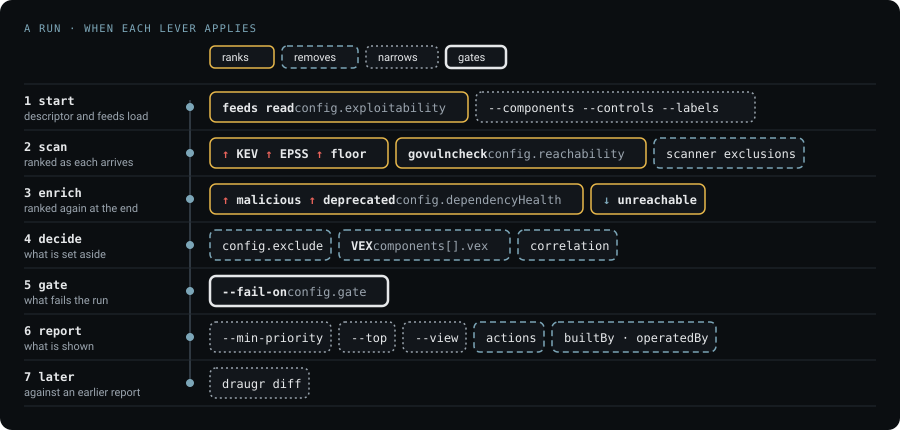
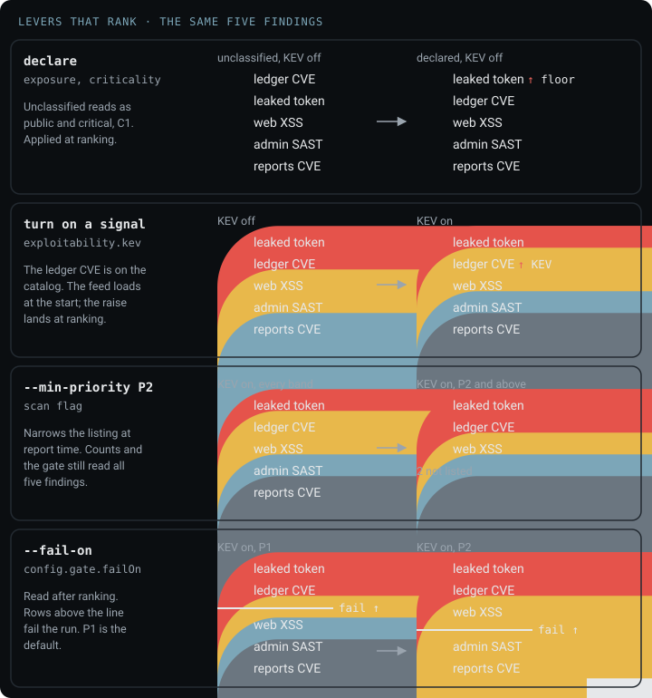
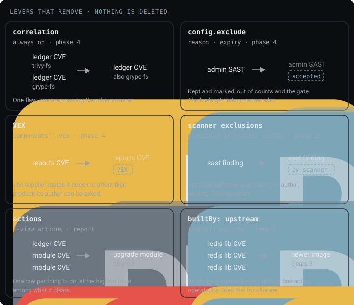
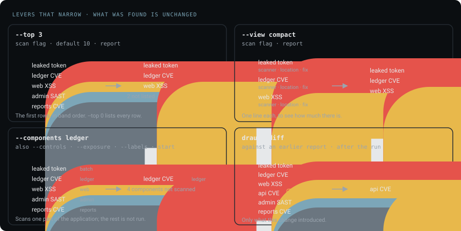

# Reducing the noise

<!-- menu: Ranking · Removal · Narrowing · Gate · Marks · Counts -->

A scan of a real project returns hundreds of findings. Most are true, and few are yours to fix this
week. A **lever** is a descriptor key or a flag that closes that gap, and each one acts at a fixed
phase of a run.



Every lever leaves a record. Ranking keeps every finding and changes its band, removal marks what it
set aside and why, and narrowing changes only what is shown. Start by declaring `exposure` and
`criticality`: without them every band is read as though each component were public and critical.

## Ranking

A **ranking lever** changes a finding's band and keeps every finding in the count. How a band is
decided is in [Prioritization](prioritization-a.md#model); the levers here are the ones you pull.
The **ledger CVE**, the finding [Prioritization](prioritization-a.md#examples) works through, is in
each list, and each list is labeled with whether KEV is on.



```yaml
components:
  - name: ledger
    exposure: internal        # public · authenticated · internal · restricted
    criticality: critical     # critical · important · supporting
```

| lever | does | applied | how it works |
|---|---|---|---|
| `exposure`, `criticality` | sets the component's tier | as each finding is ranked | [Matrices](prioritization-a.md#matrices) |
| `config.exploitability` | turns on <span class="dr-up">↑ KEV</span> and <span class="dr-up">↑ EPSS</span> | feeds read at start, applied as each finding is ranked | [Exploitability](prioritization-a.md#exploitability) |
| `config.dependencyHealth` | turns on <span class="dr-up">↑ malicious</span> and <span class="dr-up">↑ deprecated</span> | after every scanner finishes | [Dependency health](prioritization-a.md#dependency-health) |
| `config.reachability` | turns on <span class="dr-down">↓ unreachable</span>, Go only | after every scanner finishes | [Reachability](prioritization-a.md#reachability) |
| `--min-priority P2` | lists only P1 and P2; counts and the gate still read every finding | report | [`--min-priority`](../reference/cli.md#what---min-priority-narrows) |

The two fields are facts about your architecture and your business, which no scanner can compute,
and they sit in the descriptor where a reviewer sees them. A component that declares neither is
ranked as public and critical and marked `assumed` in the report, as
[Components](prioritization-a.md#components) describes. The feeds come from a local cache that
`draugr feeds update` fills, so a scan never reaches the network for them and the report names the
copy it read.

## Removal

A **removal lever** makes the count smaller and keeps each finding it removed in the report, with
the reason.



| lever | does | applied | where |
|---|---|---|---|
| correlation | one flaw found by several scanners is one row, naming the others | always on, after every scanner finishes | [Controls & scanners](controls-and-scanners.md) |
| `config.exclude` | accepts a finding with a reason and an expiry; the commit that adds the line records who | after every scanner finishes | [Saga schema](../reference/saga-schema.md#configexclude) |
| VEX | imports a supplier's statement that a vulnerability does not affect their product | after every scanner finishes | [Saga schema](../reference/saga-schema.md#reading-a-suppliers-vex-componentsvex-configvexsources) |
| scanner exclusions | a scanner set the finding aside, from a directive in the code or its own configuration | as the scanner reports | [Saga schema](../reference/saga-schema.md#configexclude) |
| actions | findings collapse into the change that clears them: three CVEs in one module are one upgrade | report, `--view actions` | [What to fix first](what-to-fix-first.md) |
| `builtBy`, `operatedBy` | a finding nobody on your team can act on is named as somebody else's | report | [What to fix first](what-to-fix-first.md#two-descriptor-fields-change-what-is-recommended) |

The three acceptance routes are counted apart in every report. `config.exclude` is a decision
somebody here committed, and the report carries the git history of each exclusion's line as the
record of who. VEX is an assertion whose author you can ask. A scanner exclusion was written outside
the descriptor with no author and no date, the weakest of the three. It splits again by where it was
written, a directive in the scanned file or a rule in the scanner's configuration, because those send
you to different people.

A scanner exclusion is counted only when the scanner keeps a record of it. A `#trivy:ignore` comment
in an IaC file and a `.gitleaksignore` entry leave none, so nothing is counted for them.

An unreachable verdict is not a removal: the finding stays in the count, one severity level lower,
because a suppression records that a person decided.

## Narrowing

A **narrowing lever** changes what you are shown, never what was found. The counts describe the whole
run, and the report says when a listing is filtered.



| lever | does | applied |
|---|---|---|
| `--top 0` | every finding rather than the first ten | report |
| `--view actions` | a row per thing to do instead of a row per finding | report |
| `--view compact` | one line each, to see how much there is | report |
| `--components`, `--controls` | scan one part of the application | start |
| `--exposure`, `--criticality`, `--labels` | scan the components matching a classification | start |
| `draugr diff` | only what a change introduced, against a report from before it | after the run |

A pull request that adds no findings needs no report read, whatever the project's standing total,
which makes `draugr diff` the narrowing lever with the largest effect.

## Gate

The **gate** is the threshold that fails a run: any finding at or above it sets the verdict to
`FAIL` and the exit code to non-zero. It reads every finding the run kept, after ranking and
removal; narrowing does not change it.

| setting | fails the run on |
|---|---|
| `--fail-on P1`, the default | a finding in P1 |
| `--fail-on P2`, or `config.gate.failOn: P2` | a finding in P1 or P2 |
| `--fail-on high` | a finding whose severity is high or critical |
| `config.gate.controls` | a threshold per control, in the gate's own vocabulary |
| `--fail-on-new P2`, or `config.gate.failOnNew` | a finding new since `--base`, in P1 or P2; this gate alone then decides |

The five findings, with KEV on, plus one the current change introduced:

| finding | band | `--fail-on P1` | `--fail-on P2` | `--fail-on-new P2` |
|---|---|---|---|---|
| leaked token | <span class="dr-p1">P1</span> <span class="dr-up">↑ floor</span> | fails | fails | passes, not new |
| ledger CVE | <span class="dr-p1">P1</span> <span class="dr-up">↑ KEV</span> | fails | fails | passes, not new |
| web XSS | <span class="dr-p2">P2</span> | passes | fails | passes, not new |
| api CVE, new | <span class="dr-p2">P2</span> | passes | fails | fails |
| admin SAST | <span class="dr-p3">P3</span> | passes | passes | passes |
| reports CVE | <span class="dr-p4">P4</span> | passes | passes | passes |

With KEV off the ledger CVE is P2, and `--fail-on P1` fails the run on the leaked token alone.
`--min-priority` leaves every verdict in the table as it is. A finding accepted through
`config.exclude` or VEX no longer counts toward any gate. The flags are in
[`scan` flags](../reference/cli.md#gating-on-new-findings), the descriptor block is
[`config.gate`](../reference/saga-schema.md#configgate), and how the verdict and exit code are
reached is in [Verdict & gating](verdict-and-gating.md).

## Marks

A **mark** names the lever that moved a finding's band, on the line under the finding. Each mark is
defined in [Signals](prioritization-a.md#signals), with what it moves and the key that turns it on.

| mark | means |
|---|---|
| <span class="dr-up">↑ KEV</span> | the CVE is on CISA's Known Exploited Vulnerabilities catalog |
| <span class="dr-up">↑ EPSS 0.62</span> | the EPSS score, printed to two places, is at or above `epssThreshold`, default 0.5 |
| <span class="dr-up">↑ malicious</span> | the package is in the OSSF Malicious Packages Project |
| <span class="dr-up">↑ deprecated</span> | the publisher marked the version deprecated |
| <span class="dr-down">↓ unreachable</span> | govulncheck found no call path to the flaw, Go only |
| <span class="dr-up">↑ floor</span> | a leaked credential, ranked at C1 whatever its component declares |
| ↩ history | the finding describes a commit rather than the current tree, so its path may be gone |

## Counts

A count that dropped because somebody accepted twelve findings and one that dropped because twelve
were fixed are different facts, and every Draugr report keeps them apart:

- **Accepted findings stay in the report**, marked, with the reason and the file and line of the
  exclusion, whose git history records who wrote it.
- **The three acceptance routes are counted separately**, never folded into one total.
- **A rule that suppressed nothing is reported**, because an exclusion doing nothing looks exactly
  like one that is working.
- **An exclusion past its expiry stops suppressing**, and the report says so.
- **A filtered listing says it was filtered**, and the counts still describe the whole run.
- **The feeds are named with their fetch time**, so a verdict that turned on KEV can be checked
  against the same copy of KEV.
