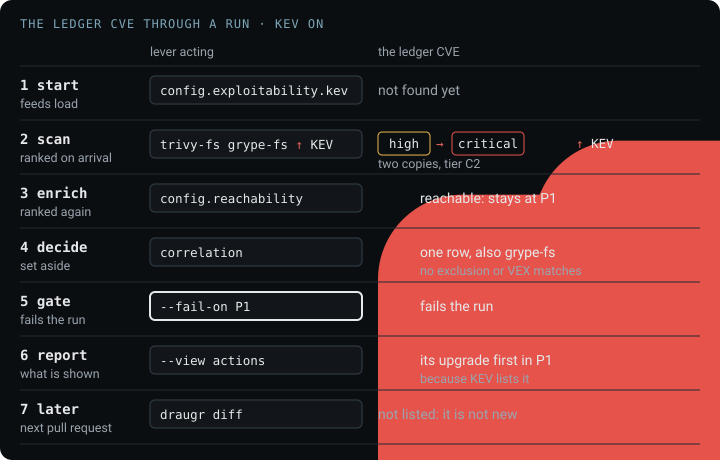
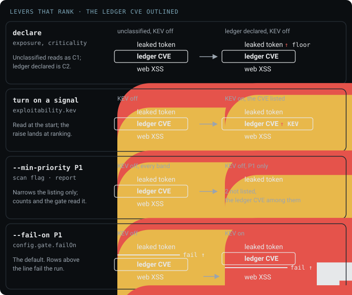
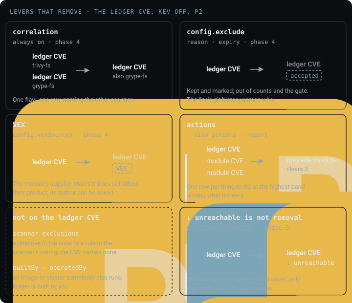
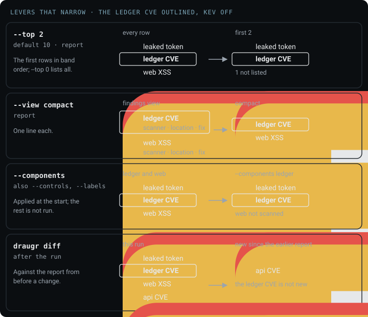

# Reducing the noise

<!-- menu: Ranking · Removal · Narrowing · Gate · Marks · Counts -->

A scan of a real project returns hundreds of findings. Most are true, and few are yours to fix this
week. A **lever** is a descriptor key or a flag that closes that gap, and each one acts at a fixed
phase of a run.

This page follows the **ledger CVE** from [Prioritization](prioritization.md#model): a CVSS 7.5
flaw, high, in a Go module that the `ledger` component depends on. `ledger` declares
`exposure: internal` and `criticality: critical`, tier C2, so the CVE ranks at P2 until a lever
moves it.



Every lever leaves a record. Ranking keeps every finding and changes its band, removal marks what it
set aside and why, and narrowing changes only what is shown. Start by declaring `exposure` and
`criticality`: without them every band is read as though each component were public and critical.

## Ranking

A **ranking lever** changes a finding's band and keeps every finding in the count. How a band is
decided is in [Prioritization](prioritization.md#model); the levers here are the ones you pull.



```yaml
components:
  - name: ledger
    exposure: internal        # public · authenticated · internal · restricted
    criticality: critical     # critical · important · supporting
```

| lever | does | the ledger CVE | how it works |
|---|---|---|---|
| `exposure`, `criticality` | sets the component's tier, as each finding is ranked | <span class="dr-p1">P1</span> unclassified, <span class="dr-p2">P2</span> declared | [Matrices](prioritization.md#matrices) |
| `config.exploitability` | turns on `↑ KEV` and `↑ EPSS`; feeds read at start, applied as each finding is ranked | <span class="dr-p1">P1</span> `↑ KEV` once listed | [Exploitability](prioritization.md#exploitability) |
| `config.dependencyHealth` | turns on `↑ malicious` and `↑ deprecated`, after every scanner finishes | <span class="dr-p1">P1</span> if its package is flagged | [Dependency health](prioritization.md#dependency-health) |
| `config.reachability` | turns on `↓ unreachable`, Go only, after every scanner finishes | <span class="dr-p2">P2</span> `↓ unreachable`, band held | [Reachability](prioritization.md#reachability) |
| `--min-priority P1` | lists only P1; counts and the gate still read every finding | not listed at <span class="dr-p2">P2</span> | [`--min-priority`](../reference/cli.md#what---min-priority-narrows) |

The two fields are facts about your architecture and your business, which no scanner can compute,
and they sit in the descriptor where a reviewer sees them. A component that declares neither is
ranked as public and critical and marked `assumed` in the report, as
[Components](prioritization.md#components) describes. The feeds come from a local cache that
`draugr feeds update` fills, so a scan never reaches the network for them and the report names the
copy it read.

## Removal

A **removal lever** makes the count smaller and keeps each finding it removed in the report, with
the reason.



| lever | does | applied | the ledger CVE | where |
|---|---|---|---|---|
| correlation | one flaw found by several scanners is one row, naming the others | always on, after every scanner finishes | one row, also `grype-fs` | [Controls & scanners](controls-and-scanners.md) |
| `config.exclude` | accepts a finding with a reason and an expiry; the commit that adds the line records who | after every scanner finishes | marked accepted | [Saga schema](../reference/saga-schema.md#configexclude) |
| VEX | imports a supplier's statement that a vulnerability does not affect their product | after every scanner finishes | marked VEX | [Saga schema](../reference/saga-schema.md#reading-a-suppliers-vex-componentsvex-configvexsources) |
| scanner exclusions | a scanner set the finding aside, from a directive in the code or its own configuration | as the scanner reports | none applies | [Saga schema](../reference/saga-schema.md#configexclude) |
| actions | findings collapse into the change that clears them | report, `--view actions` | one upgrade of its module | [What to fix first](what-to-fix-first.md) |
| `builtBy`, `operatedBy` | a finding nobody on your team can act on is named as somebody else's | report | none applies: `ledger` is yours | [What to fix first](what-to-fix-first.md#two-descriptor-fields-change-what-is-recommended) |

The three acceptance routes are counted apart in every report. `config.exclude` is a decision
somebody here committed, and the report carries the git history of each exclusion's line as the
record of who. VEX is an assertion whose author you can ask. A scanner exclusion was written outside
the descriptor with no author and no date, the weakest of the three. It splits again by where it was
written, a directive in the scanned file or a rule in the scanner's configuration, because those send
you to different people.

A scanner exclusion is counted only when the scanner keeps a record of it. A `#trivy:ignore` comment
in an IaC file leaves none, so nothing is counted for it.

An unreachable verdict is not a removal: the ledger CVE stays in the count at P2, marked
`↓ unreachable`, because a suppression records that a person decided.

## Narrowing

A **narrowing lever** changes what you are shown, never what was found. The counts describe the whole
run, and the report says when a listing is filtered.



| lever | does | applied | the ledger CVE |
|---|---|---|---|
| `--top 0` | every finding rather than the first ten | report | listed wherever it ranks |
| `--view actions` | a row per thing to do instead of a row per finding | report | inside its module's upgrade |
| `--view compact` | one line each, to see how much there is | report | one line |
| `--components`, `--controls` | scan one part of the application | start | found when `ledger` and `sca` are in scope |
| `--exposure`, `--criticality`, `--labels` | scan the components matching a classification | start | found when the filter matches `ledger` |
| `draugr diff` | only what a change introduced, against a report from before it | after the run | left out once it is in the earlier report |

A pull request that adds no findings needs no report read, whatever the project's standing total,
which makes `draugr diff` the narrowing lever with the largest effect.

## Gate

The **gate** is the threshold that fails a run: any finding at or above it sets the verdict to
`FAIL` and the exit code to non-zero. It reads every finding the run kept, after ranking and
removal; narrowing does not change it. A band gate compares a finding's band; a severity gate
compares its [ranked severity](prioritization.md#model).

| setting | fails the run on |
|---|---|
| `--fail-on P1`, the default | a finding in P1 |
| `--fail-on P2`, or `config.gate.failOn: P2` | a finding in P1 or P2 |
| `--fail-on critical`, or `config.gate.failOn: critical` | a finding whose ranked severity is critical |
| `--fail-on high` | a finding whose ranked severity is high or critical |
| `config.gate.controls` | a threshold per control, in the gate's own vocabulary; a severity there is compared with the ranked severity |
| `--fail-on-new`, or `config.gate.failOnNew` | a finding new since `--base` at or above a band or a ranked severity; this gate alone then decides |

The ledger CVE's list, plus one finding the current change introduced:

| finding | ranked severity | band | `--fail-on P1` | `--fail-on P2` | `--fail-on critical` | `--fail-on-new P2` |
|---|---|---|---|---|---|---|
| leaked token | <span class="dr-high">high</span> | <span class="dr-p1">P1</span> `↑ floor` | fails | fails | passes | passes, not new |
| ledger CVE, KEV off | <span class="dr-high">high</span> | <span class="dr-p2">P2</span> | passes | fails | passes | passes, not new |
| ledger CVE, KEV on | <span class="dr-crit">critical</span> | <span class="dr-p1">P1</span> `↑ KEV` | fails | fails | fails | passes, not new |
| web XSS | <span class="dr-med">medium</span> | <span class="dr-p2">P2</span> | passes | fails | passes | passes, not new |
| api CVE, new | <span class="dr-med">medium</span> | <span class="dr-p2">P2</span> | passes | fails | passes | fails |

KEV turns the ledger CVE's verdict under `--fail-on critical` because the gate reads the ranked
severity, not the scanner's high. An unreachable verdict works the other way: an unreachable
critical is judged high and passes `--fail-on critical`. `--min-priority` leaves every verdict in
the table as it is, and a ledger CVE accepted through `config.exclude` or VEX no longer counts
toward any gate. The flags are in [`scan` flags](../reference/cli.md#gating-on-new-findings), the
descriptor block is [`config.gate`](../reference/saga-schema.md#configgate), and how the verdict and
exit code are reached is in [Verdict & gating](verdict-and-gating.md).

<a id="what-the-marks-in-the-output-mean"></a>

## Marks

A **mark** is the label on the line under a finding that names what moved its ranking, or, for
`↩ history`, where the finding came from. Each mark is
defined in [Signals](prioritization.md#signals), with what it moves and the key that turns it on.

| mark | means |
|---|---|
| `↑ KEV` | the CVE is on CISA's Known Exploited Vulnerabilities catalog |
| `KEV listed` | the CVE is on the catalog, and the finding was critical already, so nothing moved |
| `↑ EPSS 0.62` | the EPSS score, printed to two places, is at or above `epssThreshold`, default 0.5 |
| `↑ malicious` | the package is in the OSSF Malicious Packages Project |
| `↑ deprecated` | the publisher marked the version deprecated |
| `↓ unreachable` | `govulncheck` found no call path to the flaw, Go only |
| `↑ floor` | a leaked credential, ranked at C1 whatever its component declares |
| `↑ minimum` | a leaked credential, held at high whatever its scanner rated it |
| ↩ history | the finding describes a commit rather than the current tree, so its path may be gone |

## Counts

A count that dropped because somebody accepted the ledger CVE and one that dropped because its
module was upgraded are different facts, and every Draugr report keeps them apart:

- **Accepted findings stay in the report**, marked, with the reason and the file and line of the
  exclusion, whose git history records who wrote it.
- **The three acceptance routes are counted separately**, never folded into one total.
- **A rule that suppressed nothing is reported**, because an exclusion doing nothing looks exactly
  like one that is working.
- **An exclusion past its expiry stops suppressing**, and the report says so.
- **A filtered listing says it was filtered**, and the counts still describe the whole run.
- **The feeds are named with their fetch time**, so a verdict that turned on KEV can be checked
  against the same copy of KEV.
