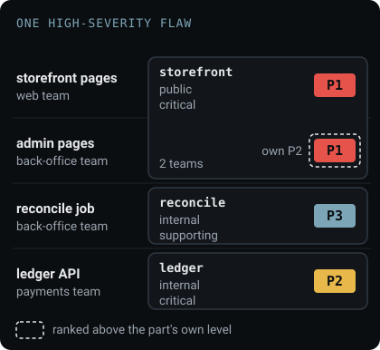
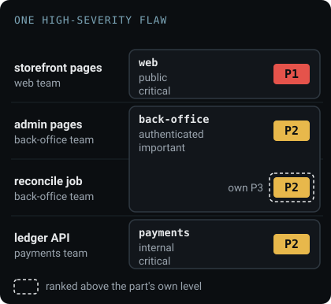
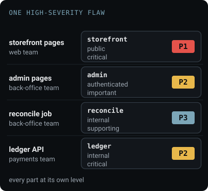

# Choose your components

A component is a part of your application that has its own answer to two questions: who can reach
it, and what happens if it fails or is breached. Usually it is something you ship and run, such as a
website, an API or a scheduled job, and sometimes a part of one that is reached differently, such as
admin pages behind a staff sign-in. A component lists the repositories, images, hosts, cluster
namespaces and cloud accounts it is built from and runs on, and every finding in them is ranked with
its `exposure` and `criticality`.

A repository has no answer to either question. It is where the code of one or more components lives,
and the same holds for a directory, a cluster and a cloud account that runs several services.

## Start from a draft

Every way of generating a Saga writes a first set of components. Each is a draft to rename and
regroup until every component answers the two questions:

- `draugr init` writes one component for the whole directory, and names in a comment the
  directories that hold their own dependency file.
- `draugr init --per-directory` writes a component for each of those directories, and a root
  component that leaves them out.
- `draugr survey github repos`, `gitlab projects` and `azure repos` write one component per
  repository.
- `draugr survey k8s images --namespace <ns>` writes one component per namespace, with its running
  images listed and its exposure proposed.

None of them writes `criticality`, and only the namespace surveyor proposes `exposure`. A component
that declares neither is ranked as `public` and `critical`, so a high or critical finding in it is P1.

## Three ways to group

The example is a shop. Its storefront service serves the public pages, which the web team owns, and
the admin pages behind a staff sign-in, which the back-office team owns. The back-office team also
runs a nightly job that reconciles orders, and the payments team runs the internal ledger API. The
same high-severity flaw is in a library all four use.

### By deployment



Each thing deployed on its own is a component. The code, image and host that run together rank
together, and an upgrade lands where it is deployed. A part reached differently ranks at its service's
level, and a service two teams build has no single owner. `draugr survey k8s images` writes this
shape where each namespace runs one service.

### By ownership



Each team's parts form one component, declared at its most exposed and most critical part. Every
finding has a team that answers for it, `split: component` opens one issue per team, and
`--components` scopes each team's pipeline. Where each team gates its own merges, give each team its
own project instead, as [Scan a monorepo](monorepos.md#decide-first-one-project-or-several) explains.

### By reach



Each part with its own answer is a component, even inside one service, and every finding ranks at its
part's level. A part split out of a repository needs its code in its own directory. An image is
scanned whole, so its findings stay with the component that lists it. In a repository, `paths:` gives
each component its own subtree:

```yaml
components:
  - name: storefront
    exposure: public
    criticality: critical
    labels: { team: web }
    repositories:
      - url: https://github.com/acme/shop.git
        paths: [web/storefront]
  - name: admin
    exposure: authenticated
    criticality: important
    labels: { team: back-office }
    repositories:
      - url: https://github.com/acme/shop.git
        paths: [web/admin]
```

[`components`](../reference/saga-schema.md#components) lists the fields for images, hosts,
namespaces and cloud accounts.

A label records ownership whichever way the components are drawn: `--labels team=back-office` scopes
a pipeline to that team's components, and a publisher's `select: { labels: { team: back-office } }`
routes their issues.

## What follows from the grouping

- **A finding is ranked in the component whose resource holds it.** A library two components use
  reports its flaw once in each, at each component's priority.
- **A `paths:` split is a sparse checkout.** A scanner handed one component does not see another
  component's code, so a flaw that flows across the boundary is not traced.
  [Scan a monorepo](monorepos.md) covers this and the root files several components share.
- **Regrouping later does not make findings new.** `draugr diff` reports the findings of a split or
  renamed component as moved, and a gate on new findings does not read moved findings. Where the new
  component declares a different exposure or criticality, the finding is also listed with its
  changed priority, and that declaration is the part to check. See
  [Gate PRs on new findings](pr-diff.md#moved-findings).

**Next:** [classify each component](classify-components.md).
