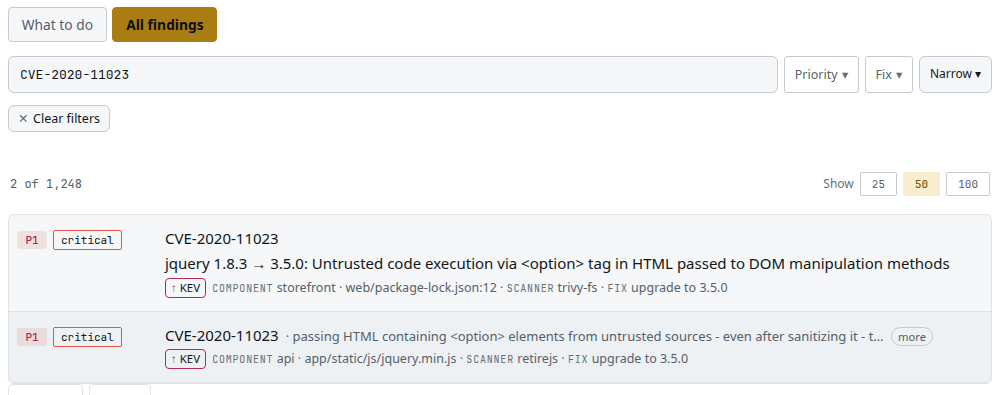
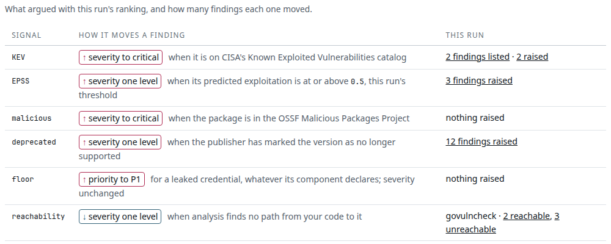
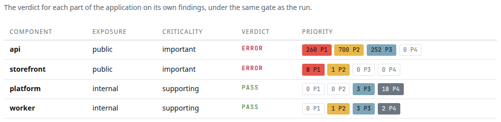

# Read a finding in the HTML report

The HTML report is one file: it loads nothing from the network, so it opens from disk, attaches to a
build, or goes in an email. This page follows one finding through it, using the
[demo sandbox](https://github.com/draugr-dev/draugr-demo), from where it ranks to what to change.

## 1. Write the report

From a clone of the demo:

```bash
draugr scan draugr.saga.yaml --kev auto --epss auto --report html -o out --no-publish
```

`--kev auto --epss auto` read the exploitation signals, so the report can show what raised a
finding; `auto` downloads both feeds the first time. `--no-publish` keeps the run on your machine,
since the demo's descriptor names publishers. Open `out/report.html` in a browser.

To skip this step, open [the demo's report from the newest release](https://draugr.dev/demo/cli/report/).

## 2. Start from what to do

The report opens on **Findings**, in the **What to do** view: one row per thing to change, most
urgent first, each naming how many findings it clears. On the demo the first row is
`Upgrade jquery 1.8.3 → 1.12.2`, in the `storefront` component, clearing four findings. That row
doesn't clear the finding this page follows; step 5 says why.

**All findings** shows every finding instead, one row each. Type a rule, a package, a file or a
message in the search box to narrow the list.

## 3. Find one finding

Search for `CVE-2020-11023`, a jQuery flaw that is being exploited, and click the first row's
sentence to show it in full:



Each row reads left to right:

- **`P1` `critical`**: its priority, then its severity.
- **The rule and what it says:** `CVE-2020-11023`, and the change that clears it,
  `jquery 1.8.3 → 3.5.0`.
- **`↑ KEV`**: a signal raised it. KEV is CISA's catalog of flaws being exploited in the wild.
- **`COMPONENT`, the location, `SCANNER`**: which part of the application, the file (with a line
  where the scanner gives one), and the tool that found it.
- **`FIX`**: what to change, here `upgrade to 3.5.0`.

The same flaw appears twice because it is in two places: the storefront's `package-lock.json`,
found by Trivy, and a copy of jQuery the api component serves from `app/static/js/`, found by
retire.js. Each is fixed separately.

## 4. See why it ranks P1

Two panes show why: **Signals** and **Components**.

**Signals** shows what argued with the ranking, and how many findings each signal moved:



`↑ KEV` on the row means CISA lists this flaw as exploited, so Draugr raised its severity to
critical. The link in the **This run** column lists the findings each signal moved.

**Components** shows what the descriptor declares about each part of the application:



`storefront` is `public` and `important`, which puts it in tier C1, and a critical finding in C1
is P1. The same finding in `worker` (`internal`, `supporting`, tier C4) would rank lower.
[The tier table](../concepts/prioritization.md#step-1-tier) has every cell.

## 5. Decide what to change

The storefront row's fix, `upgrade to 3.5.0`, is a major version, and the demo's descriptor sets
`config.fixes.upgrade: minor`, so **What to do** splits the storefront's work in two:

- `Upgrade jquery 1.8.3 → 1.12.2`, within the policy, which clears four findings;
- `Upgrade jquery 1.12.2 → 3.5.0`, marked `major, past config.fixes.upgrade: minor`, which clears
  `CVE-2020-11023` and the rest.

A row past the policy is still the fix. It's marked so the team decides on the bigger change
knowingly. The api's copy of jQuery, which the repository vendors, has rows of its own.

## 6. Set it aside instead

If the finding doesn't apply, or the risk is accepted by design, add an entry under
`config.exclude` in the descriptor, naming the rule and the file:

```yaml
config:
  exclude:
    - rules: [CVE-2020-11023]
      paths: [web/package-lock.json]
      reason: <why it is set aside>
      expires: <YYYY-MM-DD>
```

The finding stays in the report, under **Accepted**, with the reason. It counts again after
`expires`. Without `paths`, the entry sets aside every finding of the rule in every file.
[Reduce the noise](../concepts/reducing-the-noise.md) covers the other ways a finding is set aside.

## See also

- [The HTML report](reports-and-publishers.md#the-html-report): what the file holds, and its SARIF
  and TSV downloads.
- [What to fix first](../concepts/what-to-fix-first.md): how rows are ordered.
- [Prioritization](../concepts/prioritization.md): severity, exposure and criticality.
